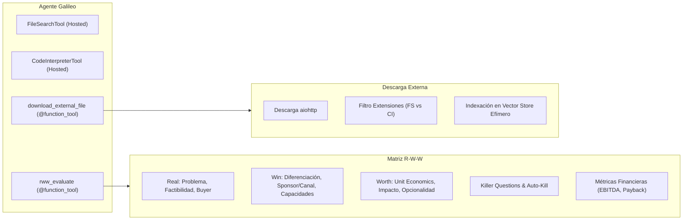

# Revisión Exhaustiva y Propuestas de Mejora: Carpeta `tools`

Este documento contiene un análisis a fondo de la intención, arquitectura, casos de borde y oportunidades de mejora para todas las herramientas ubicadas en la carpeta `tools` de **Galileo AI**, adaptadas al nuevo paradigma del **OpenAI Agents SDK**.

---

## 1. Análisis de Intención de las Herramientas Actuales

### 1.1. `rww_evaluate` (`tools/functions/rww_evaluate.py`, `tools/schemas/rww_models.py`)
- **Intención**: Implementar de forma determinística la metodología de innovación corporativa **R-W-W** (*Is it Real? Can we Win? Is it Worth it?* de George S. Day), estándar en evaluación de proyectos en Corporate Venture Capital y Venture Client.
- **Responsabilidades clave**:
  1. **Scoring ponderado 7D / 3 Pilares**: Evalúa 9 ítems distribuidos en *Real* (40 pts), *Win* (35 pts) y *Worth* (25 pts).
  2. **Análisis Financiero Incremental**: Procesa flujos (CAPEX, implementación, licencias, OPEX incremental, ahorros, nuevos ingresos) y calcula EBITDA incremental y Payback.
  3. **Killer Questions & Auto-Kill**: Aborta inmediatamente proyectos con inviabilidad regulatoria, técnica o económica irreconciliable (`KILL`).
  4. **Generación de Próximos Pasos**: Formula preguntas dirigidas para datos faltantes (`TriState.unknown`) y propone un plan piloto de 8 semanas para ideas en `PILOT` o `HOLD`.
  5. **Salida de Resumen**: Entrega versión corta (ejecutiva) y versión larga estructurada.

### 1.2. `download_external_file` (`tools/functions/download_external_file.py`)
- **Intención**: Permitir al agente recibir un enlace web público hacia un documento o dataset (ej. pitch deck en PDF, estados financieros en Excel, especificaciones técnicas), descargarlo de forma segura, clasificarlo y ponerlo a disposición del agente en OpenAI File Storage y en el Vector Store efímero de la sesión.

---

## 2. Hallazgos, Riesgos y Puntos a Corregir

### 🔍 En `rww_evaluate`:
1. **Fragilidad ante respuestas en Español del LLM (`TriState` validation)**:
   - En `rww_models.py`, `TriState` solo acepta estrictamente `["yes", "partial", "no", "unknown"]`.
   - Cuando el modelo evalúa una propuesta en español, es muy común que intente enviar `"si"`, `"sí"`, `"parcial"`, `"desconocido"`, o booleanos `True`/`False`. Esto provoca un `ValidationError` en Pydantic que cancela la tool.
   - **Solución propuesta**: Añadir un validador tolerante (`field_validator` con `mode="before"`) que normalice sinónimos en español e inglés antes de validar.

2. **Validación cruzada de umbrales (`field_validator` vs `model_validator`)**:
   - En `RWWThresholds`, la regla `hold_min < pilot_min < go_min` usa un `@field_validator("pilot_min")` accediendo a `info.data.get("go_min")`.
   - Si los parámetros se deserializan en un orden diferente o con valores parciales, `info.data` puede no contener aún `go_min`, disparando excepciones no controladas.
   - **Solución propuesta**: Migrar a `@model_validator(mode="after")`, estándar idiomático y seguro de Pydantic v2.

3. **Deprecación de `datetime.utcnow()`**:
   - En Python 3.12, `datetime.utcnow()` está formalmente deprecado y emite `DeprecationWarning`.
   - **Solución propuesta**: Sustituir por `datetime.now(timezone.utc)`.

4. **Tratamiento de `ItemAssessment` Simplificado**:
   - Para evaluar los 9 ítems, el modelo debe construir un objeto anidado `ItemAssessment(status=..., justification=..., evidence_level=...)`.
   - Si el LLM solo pasa una cadena de texto (ej. `"problem_validated": "yes"` o `"yes - dolor confirmado"`), la llamada falla.
   - **Solución propuesta**: Añadir un pre-validador en `ItemAssessment` que acepte tanto un objeto como un string o un `TriState` directo, extrayendo el status y justification automáticamente.

---

### 🔍 En `download_external_file`:
1. **Enlaces de Servicios Cloud (Google Drive, Dropbox, Box, OneDrive)**:
   - Los usuarios de CVC casi nunca envían URLs con extensión `.pdf` directa; suelen pegar enlaces compartidos como:
     - `https://drive.google.com/file/d/1A2B3C.../view?usp=sharing`
     - `https://www.dropbox.com/s/xyz/deck.pdf?dl=0`
   - Si `aiohttp` descarga esa URL directamente, descarga la página HTML del visor web de Google/Dropbox, no el archivo binario. Luego, la extensión queda como `.html` y el proceso falla o indexa código web inútil.
   - **Solución propuesta**: Incorporar un normalizador de URLs que convierta enlaces de Google Drive y Dropbox a enlaces de descarga binaria directa automática (`uc?export=download&id=...` y `dl=1`).

2. **Inyección de Contexto de Sesión (`ToolContext`)**:
   - Actualmente, `download_external_file_tool(url: str)` no recibe el ID del Vector Store efímero de la conversación actual a menos que esté en una variable global.
   - En OpenAI Agents SDK, las herramientas pueden recibir `ctx: ToolContext` como primer parámetro. Al pasar `Runner.run_streamed(..., context={"vector_store_id": vs_id})`, la herramienta accede a `ctx.context["vector_store_id"]` de forma limpia y aislada por usuario.

3. **Seguridad: SSRF y Límites de Tamaño (Memory DoS)**:
   - `resp.read()` descarga el contenido completo a memoria sin verificar `Content-Length`. Un enlace a un archivo de varios gigabytes saturaría la memoria del servidor.
   - Tampoco se validan URLs privadas (`localhost`, `127.0.0.1`, IP internas de Railway/AWS `169.254.169.254`).
   - **Solución propuesta**: Añadir límite de tamaño máximo (ej. 100 MB, acorde al límite de OpenAI) y filtro de esquemas/hosts locales.

---

### 🔍 En la Organización de `tools/`:
- `tools/__init__.py` está vacío: obliga a hacer imports largos como `from tools.functions.rww_evaluate import rww_evaluate_tool`.
- `tools/definitions/` quedó como un remanente de los diccionarios JSON de la versión anterior (OpenAI Assistants API). Con el nuevo SDK, `@function_tool` genera automáticamente el esquema.
- **Solución propuesta**: Consolidar las exportaciones en `tools/__init__.py` para que el agente y los tests importen directamente `from tools import rww_evaluate_tool, download_external_file_tool`.

---

## 3. Nuevas Herramientas Sugeridas para el Agente

Considerando la identidad de **Galileo AI** (asesor de innovación y Corporate Venture Capital):

| Herramienta Propuesta | Tipo | Justificación de Negocio para Galileo |
| :--- | :--- | :--- |
| **`WebSearchTool`** | SDK Hosted Tool | En el prompt y los starters, los usuarios piden benchmark sectoriales (ej. *«¿Cómo se compara con startups de EdTech en 2024?»*). La API de OpenAI Agents SDK incluye `WebSearchTool()` nativa para consultar métricas y tendencias de mercado en tiempo real. |
| **`cvc_7d_scoring_tool`** | `@function_tool` | Galileo tiene definida en su prompt una plantilla obligatoria de **Scoring 7D**: Estrategia 25%, Mercado 15%, Tracción 15%, Economics 10%, Equipo 10%, Riesgo 15%, Sinergia 10%. Actualmente el LLM hace el cálculo mentalmente; tener una tool dedicada garantiza consistencia matemática del 100%. |
| **`export_summary_pdf`** | `@function_tool` | Permite compilar la evaluación RWW o el resumen de un deck en un One-Pager descargable para el comité de inversión. |

---

## 4. Plan de Acción Recomendado

1. **Prioridad Alta (Robustez)**:
   - Aplicar normalización de sinónimos en español para `TriState` y tolerancia a strings en `ItemAssessment`.
   - Actualizar `RWWThresholds` con `@model_validator` en lugar de `field_validator`.
   - Incorporar normalización de URLs para Google Drive y Dropbox en `download_external_file`.
   - Usar `ToolContext` para enlazar el Vector Store efímero de cada sesión.

2. **Prioridad Media (Arquitectura)**:
   - Limpiar y enriquecer `tools/__init__.py` para una interfaz de importación unificada.
   - Deprecar `datetime.utcnow()` en favor de `datetime.now(timezone.utc)`.

3. **Prioridad Baja / Evolutiva**:
   - Activar `WebSearchTool` en el agente Galileo para consultas de benchmark de mercado.
   - Crear la herramienta de soporte para la plantilla **Scoring 7D de CVC**.
