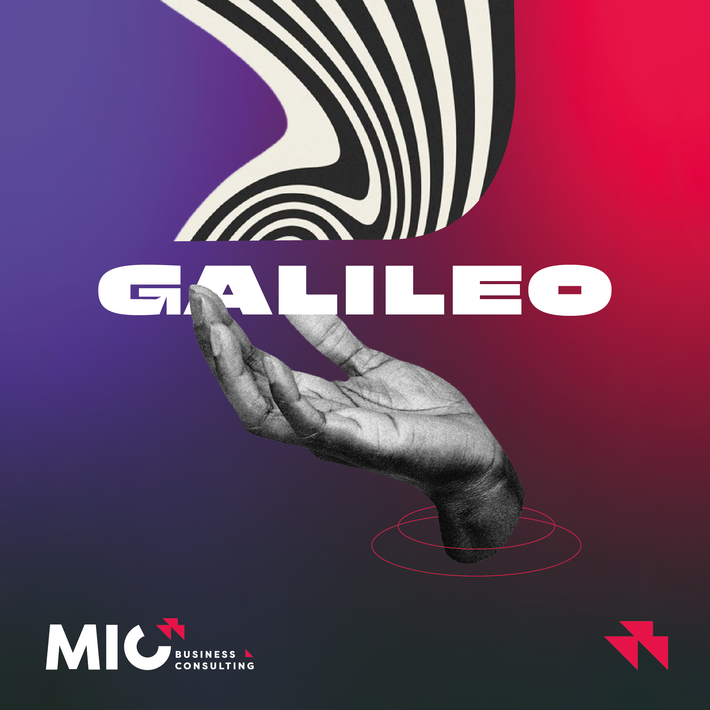

# Galileo AI – Asistente de revisión de propuestas de inversión (CVC)



**Galileo AI** es un agente conversacional, basado en la OpenAI Assistants API y presentado con la UI de [**Chainlit**](https://github.com/Chainlit/chainlit), que revisa, analiza y optimiza *decks* de inversión, documentos estratégicos y proyectos de innovación corporativa.  
Actualmente está desplegado en producción en **Railway** y lo utilizan equipos de **Corporate Venture Capital** (CVC), innovación abierta y sustentabilidad en empresas como Caja Los Andes y Antofagasta Minerals.

Galileo ha sido desarrollado por [MIC Business Consulting](https://www.micbc.cl/)

**Uso restringido a clientes y colaboradores autorizados.**

---

## ✨ Características clave

| Función | Detalle |
|---------|---------|
| **Revisión inteligente de decks** | Analiza narrativa, métricas, modelo financiero, riesgos y alineamiento estratégico con objetivos corporativos. |
| **Herramientas integradas** | `file_search` para documentos (PDF, DOCX, XLSX, …) y `code_interpreter` para cálculos, gráficos Plotly, DataFrames, etc. |
| **Streaming en tiempo real** | Tokens y pasos de código se muestran a medida que se generan. El usuario ve logs, gráficos y archivos embebidos. |
| **Uploads controlados** | Acepta únicamente los formatos soportados por la API; rechaza otros de forma elegante. |
| **Spinner “Pensando…” + Cancelación** | Feedback inmediato y botón *Stop* que aborta la ejecución (ahorra coste y tiempo). |
| **Persistencia segura** | PostgreSQL en Railway para hilos/usuarios; archivos en **Amazon S3** (`micbc-chainlit-elements`). |
| **Autenticación por e-mail** | Password + sesión firmada (`SECRET_KEY`). |
| **Internacionalización** | Interfaz en español (es-419) con fallback a inglés. |
| **Observabilidad** | Logs en `app.log`, manejo centralizado de errores vía `cl.ErrorMessage`. |

---

## 🏗️ Arquitectura

```mermaid
graph LR
  subgraph Frontend (Browser)
    A[Usuario] -- WS + HTTP --> B[Chainlit UI]
  end

  subgraph Railway
    B --> C(main.py / Chainlit Server)
    C -- Assistants API --> D(OpenAI)
    C -- SQL --> E(PostgreSQL)
    C -- S3 SDK --> F(AWS S3)
  end

  D:::cloud  F:::cloud
  classDef cloud fill:#f2f6ff,stroke:#2962ff
  ```

## `requirements.txt`

````
chainlit==2.5.5
openai>=1.69    # assistants, vision
python-dotenv>=1.0
boto3>=1.38
psycopg-binary>=3.2.6
asyncpg>=0.30
plotly>=5.20
```

## Ejecución local

```bash
git clone https://github.com/MICBC/galileo-assistant.git
cd galileo-assistant
python -m venv .venv && source .venv/bin/activate
pip install -r requirements.txt

cp .env.example .env   # rellena variables
# OPENAI_API_KEY=sk-…
# ASSISTANT_ID=asst_…
# DATABASE_URL=postgresql://…
# STORAGE_PROVIDER=s3
# AWS_ACCESS_KEY_ID=…
# AWS_SECRET_ACCESS_KEY=…
# S3_BUCKET_NAME=micbc-chainlit-elements
# SECRET_KEY=changeme

chainlit run main.py -h 0.0.0.0 -p 8000
```

## *Quick start*

| Acción                   | Ejemplo                                                               |
| ------------------------ | --------------------------------------------------------------------- |
| Analizar un deck         | “Revisa este PDF y lista los 3 principales riesgos de inversión.”     |
| Benchmark sector         | “¿Cómo se compara esta startup con benchmarks de ed-tech 2024?”       |
| Alineamiento estratégico | “¿Encaja con la tesis CVC ‘Fintech Inclusiva’?”                       |
| Reporte resumido         | “Genera un one-pager para el comité con fortalezas y métricas clave.” |


## Roadmap (ideas)

* Soporte imágenes con visión (cuando OpenAI lo libere en Assistants).
* Modo “Experto” para mostrar/ocultar código Python.
* Webhook de costos por hilo → dashboard finanzas.
* Integración con Teams.
* Arquitectura multi agente.